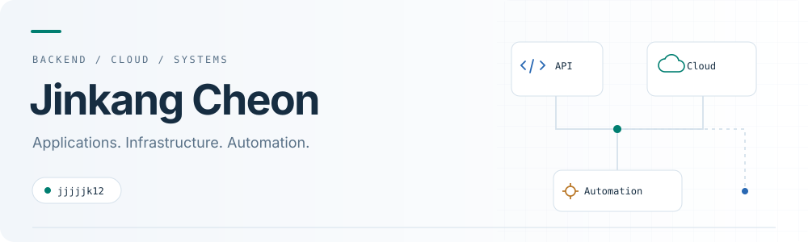

<picture>
  <source media="(prefers-color-scheme: dark)" srcset="assets/header-dark.svg">
  <source media="(prefers-color-scheme: light)" srcset="assets/header-light.svg">
  
</picture>

  <a href="#projects">Projects</a> &nbsp;·&nbsp;
  <a href="#tools">Tools</a> &nbsp;·&nbsp;
  <a href="#credentials">Credentials</a> &nbsp;·&nbsp;
  <a href="#experience">Experience</a> &nbsp;·&nbsp;
  <a href="mailto:jjjjjk1100@gmail.com">Email</a>

## 안녕하세요, 천진강입니다

**백엔드 서비스를 개발하고, 서비스가 돌아가는 클라우드 인프라를 구축·운영합니다.**

Java·Spring 기반 서비스 개발에서 시작해 AWS·OpenStack 환경의 배포 자동화와 네트워크·스토리지 운영으로 경험을 넓혀 왔습니다. 직접 사용하며 발견한 문제를 고치고, 그 과정에서 확인한 원리와 구성 이유를 기록합니다.

## Projects

<table>
<tr>
<td width="50%" valign="top">
<h3>01 &nbsp; Olim · 올림</h3>

<b>GitHub 저장소 연결부터 HTTPS 배포까지</b>

초기 개발자가 애플리케이션을 빌드하고 배포할 수 있도록 돕는 플랫폼입니다.

AWS 인프라·시스템 설계를 맡아 Terraform과 Kustomize로 환경을 구성하고, 배포 자동화와 유휴 자원 회수를 적용했습니다.

<code>AWS</code> <code>Kubernetes</code> <code>Terraform</code> <code>Kustomize</code>

<a href="https://github.com/DevX-Olim">팀 GitHub ↗</a>

</td>
<td width="50%" valign="top">
<h3>02 &nbsp; Aolda · 아올다</h3>

<b>학생 프로젝트를 위한 교내 클라우드</b>

교내 폐서버를 활용해 학생들이 프로젝트를 배포할 수 있는 OpenStack 클라우드를 함께 구축·운영했습니다.

네트워크 구성과 운영 도구 개발을 맡고, Ceph 쓰기 병목과 다중 인터페이스 VM의 통신 문제를 개선했습니다. 동아리 운영 규모는 물리 서버 7대·누적 20개 팀입니다.

<code>OpenStack</code> <code>Ceph</code> <code>Linux</code> <code>Ansible</code>

<a href="https://github.com/Aolda">동아리 GitHub ↗</a> &nbsp;·&nbsp; <a href="https://github.com/Aolda/cloud-console-backend">클라우드 콘솔 ↗</a>

</td>
</tr>
<tr>
<td width="50%" valign="top">
<h3>03 &nbsp; 메일상자</h3>

<b>여러 Gmail 계정을 하나의 작업 공간으로</b>

메일을 모아 분류·검색하고, AI 답장 초안을 제공하는 서비스입니다.

백엔드·인프라를 담당했습니다. Pub/Sub과 RabbitMQ로 메일 수신과 후속 처리를 분리하고, PostgreSQL 전문 검색과 벡터 검색을 결합했습니다.

<code>Java</code> <code>Spring Boot</code> <code>PostgreSQL</code> <code>RabbitMQ</code>

<a href="https://github.com/mailsangja/mailsangja-server">백엔드 코드 ↗</a>

</td>
<td width="50%" valign="top">
<h3>04 &nbsp; ITDA · 잇다</h3>

<b>사설 클라우드와 외부 사용자를 연결하는 접속 서비스</b>

학생 프로젝트의 도메인 프록시·TLS 인증서·SSH 포트포워딩을 관리하는 서비스입니다.

백엔드·배포·인프라를 맡아 OpenStack 계정 연동과 Nginx 설정 검증·복원 흐름을 구현했습니다. Keepalived 고가용성 구성과 IP 기반 인터페이스 탐지로 장애 전환을 보완했습니다.

<code>Spring Boot</code> <code>Nginx</code> <code>Docker</code> <code>Keepalived</code>

<a href="https://github.com/Aolda/proxy-manager-backend">백엔드 코드 ↗</a> &nbsp;·&nbsp; <a href="https://github.com/Aolda/keepalived-docker-image">Keepalived 이미지 ↗</a>

</td>
</tr>
<tr>
<td width="50%" valign="top">
<h3>05 &nbsp; My Little Aolda</h3>

<b>Mac에서 만드는 작은 OpenStack 실습 환경</b>

구성원이 개인 Mac에서 클라우드를 실습·테스트할 수 있도록 만든 프로젝트입니다.

Lima VM 3개 생성부터 Ceph, Kubernetes, OpenStack 배포와 기본 동작 확인까지 Ansible과 Atmosphere로 자동화했습니다. 설치 과정을 단계별로 실행하거나 재개할 수 있습니다.

<code>Lima</code> <code>Ansible</code> <code>Atmosphere</code> <code>OpenStack</code>

<a href="https://github.com/jjjjjk12/my-little-aolda">코드·설치 가이드 ↗</a>

</td>
<td width="50%" valign="top">
<h3>06 &nbsp; L7 Load Balancer</h3>

<b>요청 분산부터 장애 상황의 동작 검증까지</b>

여러 백엔드로 요청을 전달하는 Go 기반 L7 로드밸런서 팀 프로젝트입니다.

프록시 요청 처리와 비정상 백엔드 제외·세션 유지·분산 방식을 구현했습니다. 부하 시험과 장애 전환·설정 전파 비교 실험도 직접 수행했습니다.

<code>Go</code> <code>Linux</code> <code>wrk</code> <code>k6</code>

<a href="https://github.com/lb-ajou/loadbalancer">프로젝트 코드 ↗</a> &nbsp;·&nbsp; <a href="https://github.com/lb-ajou/reverseproxy-poc">초기 PoC ↗</a>

</td>
</tr>
</table>

## Tools

프로젝트와 운영에서 사용한 기술입니다.

| 분야 | 사용 기술 |
| :--- | :--- |
| Backend | Java · Spring Boot · PostgreSQL · RabbitMQ · Redis |
| Cloud & Containers | AWS · OpenStack · Ceph · Kubernetes · Docker |
| Automation | Terraform · Ansible · Kustomize · GitHub Actions · Bash |
| Network & Systems | Linux · Nginx · Keepalived · Go |

## Credentials

| 자격·시험 성적 | 취득·합격·평가일 |
| :--- | :--- |
| 정보처리기사 | 2026.09.11 |
| AWS Certified Solutions Architect - Associate | 2026.08.27 |
| AICE Associate | 2026.07.14 |
| TOPCIT · 수준 4, 780 / 1,000점 | 2026.05.16 |

## Experience

- **아주대학교 소프트웨어학과**
- **아올다 창립 멤버·부회장** — 교내 클라우드 운영, 백엔드·운영 도구 개발
- **AI·SW마에스트로 제17기** — DevX 팀, 올림의 AWS 인프라·시스템 설계

<b>수상 경험</b>

| 수상일 | 대회·프로그램 | 수상 |
| :--- | :--- | :--- |
| 2026.06.22 | 제25회 TOPCIT 정기평가 | 우수상 |
| 2026.06.11 | 2026-1 Ajou SoftCon 개발부문 · 메일상자 | 장려상 · 인기상 |
| 2026.06.11 | 2026-1 Ajou SoftCon 연구부문 · L7 로드밸런서 | 우수상 |
| 2026.04.04 | AI·SW마에스트로 내부 프롬프트 경진대회 | 2등 |
| 2026.03.11 | 2025 동계 모각소 | 장려상 |
| 2025.03.13 | 2024 동계 모각소 | 우수상 |
| 2024.09.10 | 2024 하계 모각소 | 최우수상 |

---

  <a href="mailto:jjjjjk1100@gmail.com">jjjjjk1100@gmail.com</a>

